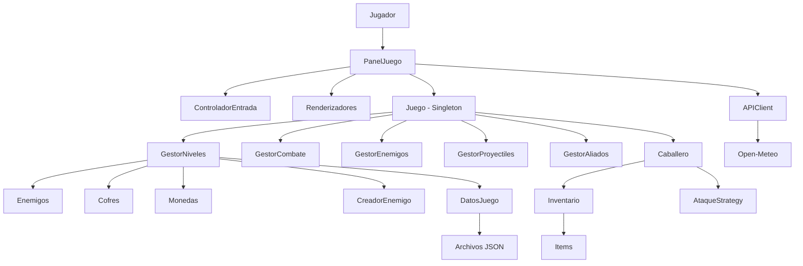

# Caballero Medieval 2D

Videojuego de plataformas, aventura y combate desarrollado en Java.

**Universidad Peruana Cayetano Heredia (UPCH)**  
Facultad de Ciencias e Ingeniería  
Carrera de Ingeniería Informática  
Curso: Programación Orientada a Objetos  
Grupo 2 | Semestre 2026-II

---

## Descripción

Caballero Medieval 2D es un videojuego académico que aplica los fundamentos de la programación orientada a objetos mediante una arquitectura modular, patrones de diseño, gestión de datos JSON y consumo de una API externa.

El jugador controla a un caballero que debe enfrentarse a diferentes enemigos, administrar sus recursos y superar tres capítulos para liberar el reino de Valdoria.

## Historia: La Fortaleza Oscura

El reino de Valdoria ha sido invadido por las fuerzas del Señor de las Sombras.

Un caballero emprende una aventura para recuperar la fortaleza y devolver la paz al reino.
Un caballero emprende una misión para recuperar la fortaleza y restaurar la paz.

La aventura se divide en tres capítulos secuenciales:

| Capítulo | Escenario | Enemigo |
|---|---|---|
| I | Bosque de las Sombras | Goblin |
| II | Fortaleza Abandonada | Guardián Oscuro |
| III | Trono de la Oscuridad | Señor de las Sombras (Boss) |

Para avanzar al siguiente capítulo, el jugador debe derrotar al enemigo correspondiente.

| Capítulo | Escenario |
|---|---|
| I | Bosque de las Sombras |
| II | Fortaleza Abandonada |
| III | Trono de la Oscuridad |

El jugador debe derrotar a los enemigos del capítulo y alcanzar el portal para continuar su aventura.

## Características principales

- Movimiento horizontal, salto y gravedad.
- Combate cuerpo a cuerpo y a distancia.
- Enemigos con detección y persecución.
- Jefe final con ataques especiales.
- Sistema de aliados.
- Inventario y barra de acceso rápido.
- Equipamiento de armas, escudos y armaduras.
- Sistema de durabilidad de armas.
- Munición y proyectiles.
- Comida, pócimas y habilidades.
- Habilidad temporal Furia.
- Cofres interactivos y monedas coleccionables.
- Compra de recuperación de vida.
- Tres capítulos con progresión narrativa.
- Menús de pausa y derrota.
- Reinicio de capítulos.
- Condiciones de victoria y derrota.
- Clima ambiental mediante Open-Meteo.
- Configuración mediante archivos JSON.
- Pruebas automatizadas del dominio.

## Tecnologías utilizadas

| Tecnología | Propósito |
|---|---|
| Java | Lenguaje principal |
| Java Swing | Interfaz gráfica |
| Java2D | Renderizado del videojuego |
| Gson | Procesamiento de JSON |
| Java HttpClient | Consumo de API REST |
| Open-Meteo | Información meteorológica |
| Git | Control de versiones |
| GitHub | Integración y colaboración |
| Visual Studio Code | Entorno de desarrollo |

## Arquitectura

El proyecto separa las responsabilidades del dominio, la gestión del videojuego, la presentación y el acceso a datos.



## Organización del proyecto

```text
CaballeroMedieval2D/
├── data/
│   ├── enemigos.json
│   ├── historia.json
│   ├── items.json
│   └── niveles.json
├── lib/
├── src/
│   ├── entidades/
│   ├── escenario/
│   ├── interfaces/
│   ├── items/
│   │   ├── herramientas/
│   │   └── consumibles/
│   └── juego/
├── tests/
│   └── PruebasJuego.java
└── README.md
```

### Componentes principales

| Componente | Responsabilidad |
|---|---|
| Entidad | Abstracción de los personajes |
| Caballero | Protagonista, movimiento, combate e inventario |
| Enemigo | Comportamiento de los adversarios |
| Boss | Especialización de enemigo |
| Aliado | Apoyo al protagonista |
| Inventario | Administración de objetos |
| Juego | Coordinación general de la partida |
| GestorNiveles | Configuración de capítulos y elementos del escenario |
| GestorCombate | Coordinación de ataques |
| GestorEnemigos | Comportamiento de enemigos |
| GestorAliados | Comportamiento de aliados |
| GestorProyectiles | Movimiento y colisiones de proyectiles |
| ControladorEntrada | Registro de controles |
| Renderizadores | Representación gráfica |
| APIClient | Comunicación con la API externa |
| DatosJuego | Acceso a configuraciones JSON |

## Fundamentos de programación orientada a objetos

### Encapsulamiento

El estado interno de las entidades y objetos se administra mediante métodos de consulta y modificación controlada.

### Herencia

Caballero, Enemigo y Aliado heredan de Entidad. Boss especializa el comportamiento de Enemigo.

### Abstracción

Entidad, Item, Herramienta y Consumible representan conceptos generales que se especializan mediante subclases.

### Polimorfismo

Los personajes, objetos y estrategias proporcionan implementaciones específicas de sus respectivos contratos.

### Relaciones entre objetos

- Composición: Caballero e Inventario.
- Agregación: Inventario e Item.
- Asociación: Caballero y su estrategia de ataque.
- Dependencia: Cofre e Inventario durante la apertura.
- Realización: Entidad y Estructura implementan Atacable.

## Patrones de diseño

| Patrón | Tipo | Implementación |
|---|---|---|
| Singleton | Creacional | Juego |
| Factory Method | Creacional | CreadorEnemigo |
| Strategy | Comportamiento | AtaqueStrategy |
| Observer | Comportamiento | Entidad y PropertyChangeSupport |

### Singleton

Centraliza la coordinación de la partida mediante una única instancia de Juego.

### Factory Method

Permite crear enemigos normales y jefes mediante creadores especializados que interpretan datos JSON.

### Strategy

Permite seleccionar diferentes comportamientos de ataque según el equipamiento del caballero.

### Observer

Notifica cambios en la vida del personaje y permite que la interfaz reaccione mediante efectos y avisos visuales.

## Integración con API externa

El videojuego consulta información meteorológica de Lima, Perú, mediante la API de Open-Meteo.

La clase APIClient centraliza:

- Solicitudes HTTP asíncronas.
- Procesamiento de respuestas JSON.
- Validación de respuestas HTTP.
- Tiempo máximo de conexión.
- Tiempo máximo de solicitud.
- Manejo de excepciones.
- Clima de respaldo cuando no hay conexión.

La consulta meteorológica permite modificar los efectos ambientales sin que la disponibilidad del servicio sea un requisito para jugar.

Documentación: https://open-meteo.com/en/docs

## Controles

| Control | Acción |
|---|---|
| A | Mover a la izquierda |
| D | Mover a la derecha |
| Espacio | Saltar |
| J | Atacar |
| E | Abrir cofre cercano |
| I | Abrir o cerrar inventario |
| X | Eliminar objeto seleccionado |
| H | Comprar recuperación de vida |
| 1-9 | Seleccionar objeto de la barra |
| Rueda del ratón | Cambiar selección |
| Clic izquierdo | Utilizar objeto seleccionado |
| Clic derecho | Atacar |
| Clic derecho en inventario | Utilizar objeto |
| Esc | Pausar o cerrar inventario |
| Enter | Continuar historia o reanudar |
| R | Reiniciar después de una derrota |

## Requisitos

- JDK 17 o superior.
- Git.
- Entorno gráfico compatible con Swing.
- Librerías incluidas en lib/.
- Conexión a internet opcional para el clima.

## Instalación y ejecución

### Clonar el repositorio

```bash
git clone https://github.com/aldairchavez12/CaballeroMedieval2D.git
cd CaballeroMedieval2D
```

### Windows - PowerShell

Compilar:

```powershell
New-Item -ItemType Directory -Path out -Force | Out-Null

$archivos = Get-ChildItem src -Recurse -Filter *.java |
    ForEach-Object { $_.FullName }

javac -encoding UTF-8 -cp "lib/*" -d out $archivos
```

Ejecutar:

```powershell
java -cp "out;lib/*" juego.Main
```

### Linux y macOS

Compilar:

```bash
mkdir -p out

find src -name "*.java" -print0 |
    xargs -0 javac -encoding UTF-8 -cp "lib/*" -d out
```

Ejecutar:

```bash
java -cp "out:lib/*" juego.Main
```

Ejecutar siempre desde la raíz del repositorio para que el programa encuentre los archivos de configuración.

## Pruebas automatizadas

El archivo tests/PruebasJuego.java contiene casos de prueba para validar las principales reglas del dominio.

### Windows

```powershell
javac -encoding UTF-8 -cp "out;lib/*" -d out tests/PruebasJuego.java

java -cp "out;lib/*" PruebasJuego
```

### Linux y macOS

```bash
javac -encoding UTF-8 -cp "out:lib/*" -d out tests/PruebasJuego.java

java -cp "out:lib/*" PruebasJuego
```

Las pruebas cubren inventario, combate, economía, monedas, cofres, habilidades, patrones de diseño y otras mecánicas.

## Control de versiones

El desarrollo utiliza ramas de trabajo y commits incrementales.

- main: versión integrada del proyecto.
- feature/integracion-final: integración de componentes.
- Ramas feature: desarrollo de funcionalidades específicas.

El historial de Git permite identificar las contribuciones realizadas por los integrantes.

## Equipo académico

### Presentado por

- Avilez Salinas, Harold Dair.
- Chavez Aliaga, Aldair Alexander.

### Docentes

- Emanuel Ortiz Ortiz.
- Wilder Nina Choquehuayta.

## Limitaciones y mejoras futuras

- Incorporación de sprites y animaciones más detalladas.
- Música y efectos de sonido.
- Mejoras en las colisiones del escenario.
- Ampliación de niveles y enemigos.
- Optimización de recursos gráficos.
- Mayor cobertura de pruebas automatizadas.

---

Caballero Medieval 2D  
Universidad Peruana Cayetano Heredia  
Ingeniería Informática | Programación Orientada a Objetos | 2026-II